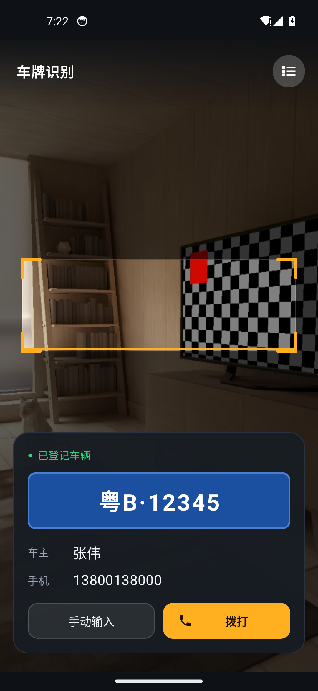
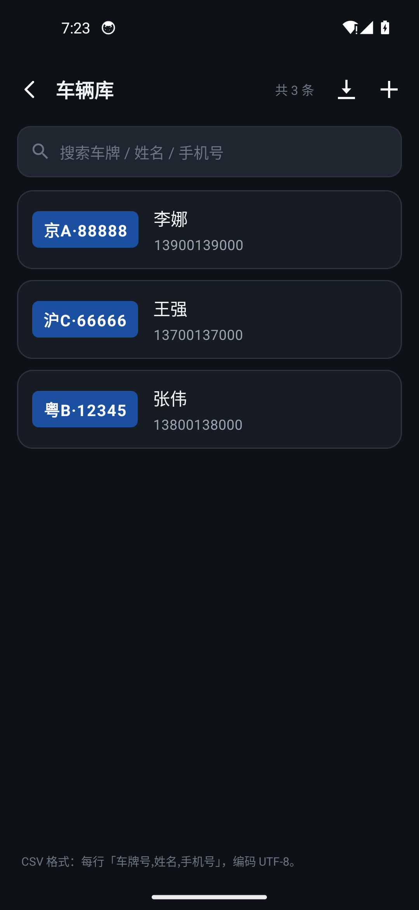

# 车牌查询（PlateLookup）

面向**学校、园区、车队等自有车辆**的本地查询工具：摄像头对准车牌，识别出号码后立刻在手机本地车辆库里查出车主姓名与手机号，
用于出车登记、门岗核验、访客车辆确认这类场景。

整条链路纯离线——不联网、不上传、不申请任何网络权限，车辆档案由使用者自行录入并存在本机 SQLite 里。

> **合规使用声明**
> 本项目仅用于学校等单位对自有车辆、登记车辆的本地信息管理，档案由使用者自行录入并存储在设备本地。
> 请勿用于非法获取、买卖或公开他人个人信息，请勿用于跟踪、骚扰他人。车牌号与车主姓名、手机号的组合属于个人信息，
> 收集与使用需遵守《中华人民共和国个人信息保护法》《网络安全法》等法律法规，并取得信息主体的授权（学校场景下应取得教职工/车主的知情同意，并做到最小必要、限定用途）。
> 因使用不当造成的后果由使用者自行承担。

## 下载

| 渠道 | 链接 |
| --- | --- |
| GitHub Release（APK 直链） | <https://github.com/jaspermzx/chepai-chaxun/releases/latest> |
| Gitee 镜像仓库 | <https://gitee.com/jaspermzx/chepai-chaxun> |
| GitHub 镜像仓库 | <https://github.com/jaspermzx/chepai-chaxun> |

当前版本 **v1.1.0**（2026-11-24）。APK 为 debug 签名，45.8 MB，SHA-256：
`e6443b412be941da721aa7c03f73da003a18bffc7cf779acd44cb629ee4034e7`

## 一、功能

| 能力 | 说明 |
| --- | --- |
| 实时识别 | 相机预览中持续识别，识别到车牌即自动查询并展示结果 |
| 本地查询 | 车牌号精确匹配；未命中时自动尝试 OCR 易混淆变体（0/O、1/I/L、2/Z、5/S、8/B、6/G、4/A、7/T） |
| 车辆库 | 增 / 删 / 改 / 查，支持按车牌、姓名、手机号搜索 |
| 批量导入 | CSV 批量导入（UTF-8 / GBK 自适应，逗号/制表符/分号分隔）；**手机号可留空**，缺手机号不再丢人 |
| 导入容错 | 车牌单元格混入序号、书名号、中文说明时自动剥离；同车牌重复行以后者为准；导入后反馈新增/更新/无手机号/跳过各多少 |
| 模糊查询 | 手动输入**只输几位**（如 `12345`、`B2`）即可查，唯一命中直接展示，多条命中弹选择框 |
| 无手机号 | 车主没登记手机号时保留原布局，只显示姓名，手机号位显示「无信息」，拨打按钮自动隐藏 |
| 拨打 | 命中后可直接跳到拨号盘（仅跳转，不自动外拨） |
| 补光 | 环境光不足时开手电筒提高识别率 |
| 示例数据 | 首次启动写入 4 条示例档案（含一条「数字工号 + 无手机号」），装完即可验证全流程 |

## 二、技术栈

- **CameraX 1.3.4**：预览 + `ImageAnalysis` 帧分析（KEEP_ONLY_LATEST，目标 1280×720）
- **ML Kit `text-recognition-chinese` 16.0.1（bundled）**：中文文字识别模型随 APK 打包，纯端侧推理，无需下载模型、无需 Google Play 服务
- **SQLite（SQLiteOpenHelper）**：单表 `vehicles(plate, owner, phone, updated_at)`，车牌号主键
- **纯 Java 17 / AGP 8.5.2 / Gradle 8.7**，minSdk 24 / targetSdk 34

识别链路：`CameraX 帧 → InputImage → ML Kit OCR → 正则提取车牌（省份简称 + 发牌机关字母 + 5~6 位序号）→ 归一化 → 变体查询 → 展示`

## 三、界面

| 识别结果 | 车辆库 |
| --- | --- |
|  |  |

## 四、目录

```
PlateLookup/
├── app/src/main/java/com/platelookup/
│   ├── MainActivity.java        相机 + OCR + 查询 + 结果展示
│   ├── VehicleListActivity.java 车辆库（增删改查 / CSV 导入）
│   ├── VehicleStore.java        SQLite 访问层 + 变体查询
│   ├── PlateParser.java         车牌提取 / 归一化 / OCR 混淆变体
│   ├── CsvImporter.java         CSV 解析
│   ├── Vehicle.java             数据模型
│   └── ScanOverlayView.java     取景框（压暗 + 角标 + 扫描线）
├── app/src/main/res/            布局、颜色、主题、图标
├── sample-vehicles.csv          导入模板
└── app/build/outputs/apk/debug/app-debug.apk   构建产物
```

## 五、构建

环境：JDK 17、Android SDK（platform 34 + build-tools 34.0.0）。

```bash
# 1) 配置 SDK 路径（local.properties 不入库，需要自己建）
echo 'sdk.dir=/path/to/Android/Sdk' > local.properties

# 2) 构建
./gradlew assembleDebug          # Windows: gradlew.bat assembleDebug
# 产物：app/build/outputs/apk/debug/app-debug.apk
```

`gradle/wrapper/gradle-wrapper.properties` 里用的是腾讯云镜像（国内拉发行包更快）。
如需官方源，把 `distributionUrl` 换成 `https\://services.gradle.org/distributions/gradle-8.7-bin.zip` 即可。

用 Android Studio 打开工程直接 Run 也可以。

## 六、安装与使用

1. 把 `app-debug.apk` 传到手机安装（需允许「安装未知来源应用」）。
2. 首次打开授予相机权限。
3. 把车牌放进取景框，稳定 1~2 秒，识别成功会震动并在底部卡片显示车主姓名与手机号。
4. 点右上角列表图标进入「车辆库」：点条目编辑、长按删除、右上角 `+` 新增、↓ 图标导入 CSV。
5. CSV 格式（UTF-8，第一行表头可省略）：

```csv
车牌号,姓名,手机号
粤B12345,张伟,13800138000
```

## 七、离线与隐私

- APK 内**没有任何网络权限**（`INTERNET` / `ACCESS_NETWORK_STATE` 已在 manifest 中显式移除），系统层面就发不出请求。
- 模型文件在 `assets/mlkit-google-ocr-models/`，识别全程在本机完成。
- 数据存于应用私有目录 `databases/vehicles.db`，卸载即删除；`allowBackup=false`，不进云备份。
- 相机画面只在内存中逐帧处理，不落盘、不上传。

## 八、验证记录（Android 14 模拟器实测）

| 项 | 方式 | 结果 |
| --- | --- | --- |
| 编译打包 | `gradle assembleDebug` | BUILD SUCCESSFUL，APK 47 MB |
| 安装启动 | `adb install` + `am start` | 正常启动，无崩溃 |
| 识别→查库→展示 | 用生成的「粤B·12345」车牌图跑识别 | 显示「已登记车辆 / 粤B·12345 / 张伟 / 13800138000」，拨打按钮出现 |
| 未登记分支 | 用「苏E·8K3M9」跑识别 | 显示「本地库中无此车牌」，车主手机为「—」 |
| 车辆库列表 | 进入车辆库 | 3 条种子数据正确渲染，计数「共 3 条」 |
| CSV 导入 | 从 Downloads 选 `vehicles-test.csv` | Toast「已导入 2 条」，列表变 5 条，中文正常 |
| 搜索 | 输入 `8888` | 过滤为 1 条（京A·88888） |
| 编辑对话框 | 点列表项 | 三个字段正确回填，删除/取消/保存可用 |
| 格式校验 | 手动输入 `A123` 点确定 | 原地报错，对话框不关闭 |
| 离线属性 | `aapt2 dump permissions` | 只有 `CAMERA`、`VIBRATE`，无任何网络权限 |

### v1.1.0 增量验证

| 项 | 方式 | 结果 |
| --- | --- | --- |
| 无手机号不再丢行 | 导入含「两列行 / 手机号写『无』」的 CSV | Toast「导入 5 条（新增 2，更新 3），其中 3 条无手机号」，5 条全部入库 |
| 数字人名 | 姓名字段为 `236` | 正常入库并以 `236` 展示 |
| 脏车牌剥离 | `1. 粤B23456`、`粤B·23456`、`编号：粤B34567（校车）` | 均正确剥离为 4 位车牌并入库 |
| 无手机号展示 | 查无手机号记录 | 布局不变，只显示姓名，手机号位「无信息」，拨打按钮隐藏 |
| 空手机号保存 | 编辑该记录直接保存 | 保存成功（旧版会拦「手机号不能为空」） |
| 部分车牌查询 | 手动输入 `23456` | 唯一命中，展示「粤B·23456 / 236 / 无信息」，状态「已登记车辆 · 模糊匹配」 |
| 多命中 | 手动输入 `23` | 弹出「匹配到 2 辆车，请选择」，列表标注「（无手机号）」 |

逻辑层另有 34 条纯 JVM 用例（车牌提取/归一化/变体/CSV 容错导入/手机号清洗）全部通过，见 `tools/PlateParserTest.java`。

> 运行期曾捕获一个真实缺陷：命中后震动缺少 `VIBRATE` 权限导致 `SecurityException` 崩溃，已补权限并加兜底 try/catch。

## 九、自测入口（仅 debug 包）

```bash
adb push your-plate.png /data/local/tmp/plate.png
adb shell am start -n com.platelookup/.MainActivity -e test_image /data/local/tmp/plate.png
```

debug 包会读这张图跑一次完整识别链路；正式包忽略该参数（代码里用 `FLAG_DEBUGGABLE` 做了门控）。

## 十、已知限制

1. **识别用的是通用 OCR，不是专用车牌检测模型**：车牌在画面中占比过小、强反光、大角度倾斜、夜间噪点重时会漏识或错字（错字可由变体匹配兜底一部分）。
2. 识别为「逐帧 + 单帧结果」：不做多帧投票，个别情况会短暂显示错字车牌。
3. **部分车牌模糊查询只作用于手动输入**：相机识别仍要求完整车牌，避免半截号码误命中。
4. 省份简称识别依赖中文 OCR，模型对艺术字/污损车牌效果一般。
5. 仅处理蓝牌/绿牌等民用车牌格式；港澳入境车牌、使馆车牌等特殊格式未做专门处理。
6. APK 约 48 MB（中文 OCR 模型 + 4 个 ABI 的 native 库），如需瘦身可用 ABI split 或 App Bundle。
7. 当前产物是 **debug 签名**，可直接安装自测；对外分发请换成自己的 release 签名。
8. 真机（尤其低端机）建议再跑一遍：不同后摄的对焦/曝光策略会影响识别率，模拟器无法覆盖。
9. 移除网络权限后，ML Kit 自带遥测会在后台打一条 `TransportRuntime` 告警（`Error scheduling event ... ACCESS_NETWORK_STATE`），不会崩溃、不影响识别，属于预期行为。
10. 车辆库是明文 SQLite，未加密；如需防翻查可接 SQLCipher 或对姓名/手机号字段单独加密。

## 十一、后续可升级方向

- 接专用车牌检测（YOLOv8n 车牌检测 + LPRNet 识别，NCNN/TFLite），先裁 ROI 再识别，准确率和容错会明显优于整图 OCR。
- 多帧投票：连续 N 帧同一车牌才判定命中，消除抖动。
- 拍照模式：用 `ImageCapture` 拍一张高分辨率再识别，适合远距离/反光场景。
- 批量导入改为读取 Excel（xlsx），或从通讯录/企业微信导入。
